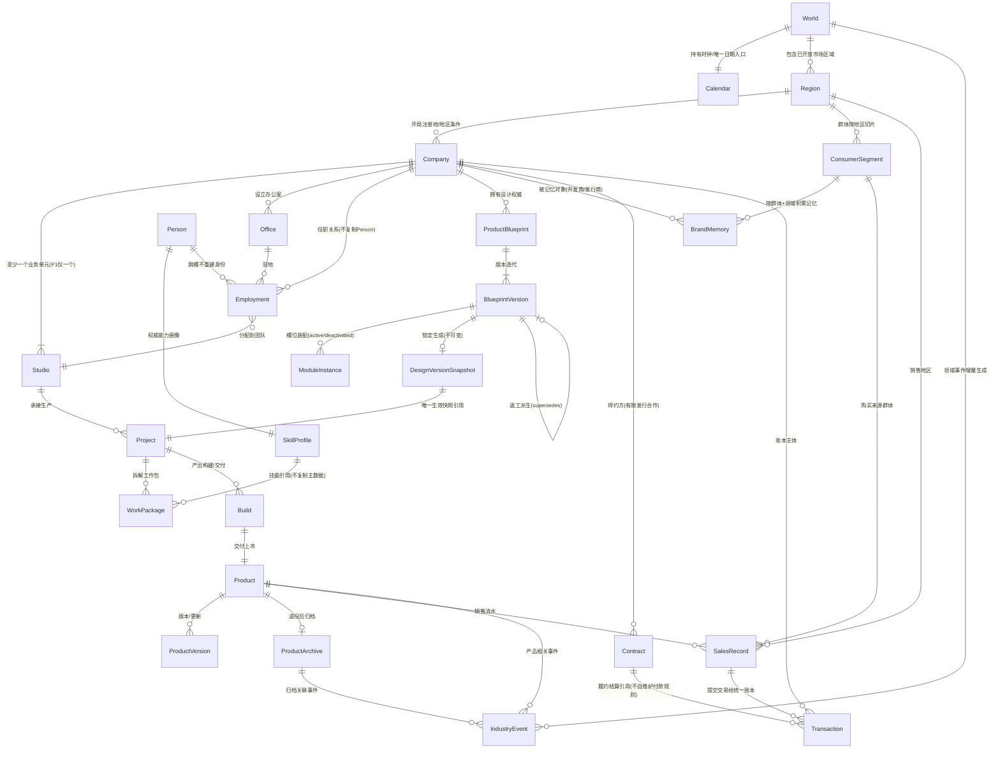

# P0 核心实体关系、模拟时序与首批可玩场景 V0.1

| 字段 | 内容 |
|---|---|
| 文档编号 | P0-B / P0-CORE-REL |
| Task ID | TASK-P0-B |
| 版本 | V0.1（P0 设计综合稿） |
| 状态 | DESIGN_DRAFT（P0 综合，不进入编码） |
| 阶段 | P0 产品规则重整 → 输入 P1 单工作室可玩闭环 |
| 上游权威 | `docs/baseline/00_项目总纲/01_总体设计基线.md`（§3 核心循环、§14 红线）、`docs/baseline/01_系统总体规划/01_系统地图与领域规则.md`（§2 权威边界、§3 核心实体、§7 性能分层）、`docs/baseline/02_版本路线图/01_开发阶段与验收门槛.md`（§3 P0 产出、§4 P1 验收）、`docs/baseline/03_决策基线/01_已确认设计决策与待验证事项.md`、`docs/design/01_产品蓝图与玩法模块体系设计规格_V0.2.md`（D-01，DESIGN-D01，已 DONE 关闭） |
| D-01 引用约定 | 本文 `D-01 §x` 均指上列 V0.2 文件（文件名 V0.2、正文首页标题仍写 V0.1，属文档标题笔误，不影响内容权威；见 §1.5 冲突点 C-0） |
| 本文不涉及 | D-02/D-03/D-04/D-05/D-06/D-07 详细规格、Project/WorkPackage 详细规格、代码、UI 像素级规格、数值终值 |
| 范围声明 | **仅 P1 范围**。不为 P2+ 系统预留字段；远期实体（Franchise、Update、SequelLink、MarketTrend、Negotiation、Milestone、TechnologyDomain、Platform 完整经营、Mentorship、PersonRelationship、OrganizationPolicy、CompanyCapability 等）不在图中，仅在交接清单 §5 说明 |

**状态标记**（沿用 `docs/baseline/README.md`）：
`CONFIRMED` 用户已确认方向；`DESIGN_BASELINE` 总设计师默认裁定，可经证据推翻；`TUNING` 结构确定、参数待校准；`OPEN` 需后续专项设计，不伪装为已定；`DEFERRED` 明确后置；`REJECTED` 当前规划不做。

---

## 0. 文档立场与阅读方式

1. 本文是 **P0 设计综合**，不是新系统规格。它把 V3.0 基线与已关闭的 D-01 翻译成 P1 可实施的实体关系、时序原则和场景，但不定义 D-02/Project/人才/市场/财务的内部公式与状态机（见 §5）。
2. **权威顺序**：基线（总纲/系统地图/路线图/决策基线） > 已关闭的 D-01 V0.2 > 本文的综合裁定 > V2.1.7 旧规格。与 D-01 冲突时以 D-01 为准，冲突点集中列于 §1.5 与 §4.0。
3. D-01 已完整定义 `ProductBlueprint` 及其设计子实体的字段（D-01 §4）。本文 §2 对这些实体**只列 P1 关键引用与关系字段**，不复制其完整字段表；完整字段以 D-01 §4 为准。
4. 所有未定口径标 `OPEN`；`TUNING` 参数不填终值。可观察到的数值在场景中以"区间/档位"表达，不写成确定值。

---

## 1. 核心实体关系图（P1 范围）

### 1.1 Mermaid 实体关系图

> 实体名用代码标识符；关系标签说明基数与因果。图中 `BlueprintVersion` 是 D-01 引入的必要桥梁实体（设计版本），与团队指定的 24 个核心实体共同构成 P1 最小闭环。



### 1.2 关系文字说明（按因果链分组）

**A. 世界与时间（前置条件层）**
- `World` 持有唯一 `Calendar`；所有日期来自 Calendar（迁移裁定 `KEEP`：GameCalendar 唯一日期入口）。
- `World` 包含若干 `Region`（P1 只用玩家开局地区及其少数市场切片，P4 才扩全球）。
- `World` 生成 `IndustryEvent`：事件由领域动作产生，不由 UI 拼接（系统地图 §2.2）。

**B. 企业与组织（决策主体层）**
- `Region` 提供 `Company` 的注册地与地区条件（工资/租金/人才池/购买力档位，具体口径 OPEN→D-03/D-04）。
- `Company` 至少有一个 `Studio`；P1 固定一个 Studio + 一个 Office，多工作室/多地区 `DEFERRED`（P5）。
- `Person` 与 `Employment` 分离：`Person` 是身份，`Employment` 是任职关系；跳槽不复制或重建 Person（系统地图 §3.3）。`Studio` 只记录分配关系，不复制人物主数据（§2.2）。

**C. 产品设计 → 执行 → 上市（主链单向，D-01 §3.1）**
- `Company` 拥有 `ProductBlueprint`（设计权威）；一个蓝图多个 `BlueprintVersion`（迭代）。
- 每个版本装配若干 `ModuleInstance`（P1 槽位开放 `core_loop×1 / support×2 / content×1`，D-01 §4.4）。
- 版本 `LOCKED` 时生成唯一 `DesignVersionSnapshot`（不可变，冻结 `estimates` 与 `templateRevisionRefs`，D-01 §4.12）。
- `Project` **只引用一个** `snapshotId`（唯一生效快照，`formulaVersion` 随存，D-01 §15.1）；执行期不回写蓝图。
- 返工完成只派生新版本（`supersedes` 指向旧）与新快照，再切换 `Project.snapshotId`（D-01 §7.2/§15.3）。
- `Project` 拆解 `WorkPackage`，工作包引用 `SkillProfile`（技能引用，非复制）；日推进产出 `Build`。
- `Build` 交付后成为 `Product`（上市后持续存在的商业与历史实体，系统地图 §2.2）；`Product` 有 `ProductVersion`，退役后进 `ProductArchive`。

**D. 市场 → 销售 → 财务（反馈层）**
- `Region` 切片出 `ConsumerSegment`；`Company`/产品被按群体+领域记忆为 `BrandMemory`（权威归消费者系统，§2.2）。
- `Product` 在 `ConsumerSegment`/`Region` 上产生 `SalesRecord`；每条销售向统一账本提交 `Transaction`。
- `Contract`（P1 仅有限发行合作）记录义务，其履约结算引用 `Transaction`；合同不维护第二套付款/分成规则（§2.2）。
- 现金只在统一账本变动；业务系统不得直接改现金（§2.2，FinanceService 唯一现金入口 `KEEP`）。

**E. 档案层**
- `ProductArchive` 关联 `IndustryEvent`，支持从编年史下钻到实体与因果（系统地图 §4.8、D-07 接口 OPEN）。

### 1.3 一对多 / 多对多关系表

| 关系 | 基数 | 类型 | 权威/说明 |
|---|---|---|---|
| World → Calendar | 1:1 | 唯一入口 | 世界与时间系统 |
| World → Region / IndustryEvent | 1:N | 一对多 | 世界与时间 |
| Company → Studio / Office / Employment / Blueprint / Contract / Transaction / BrandMemory | 1:N | 一对多 | 企业/财务/消费者系统各自权威 |
| Person → Employment / SkillProfile | 1:N / 1:1 | 一对多 + 一对一 | 人物系统；身份不复制 |
| ProductBlueprint → BlueprintVersion → ModuleInstance | 1:N / 1:N | 一对多 | D-01 设计权威 |
| BlueprintVersion → DesignVersionSnapshot | 1:0..1 | 一对一（可选） | D-01 锁定生成 |
| DesignVersionSnapshot → Project | 1:1 | 一对一（唯一生效） | D-01 执行权威 |
| Project → WorkPackage / Build | 1:N | 一对多 | Project 规格 OPEN |
| Product → ProductVersion / SalesRecord / IndustryEvent | 1:N | 一对多 | 产品/市场/档案系统 |
| **Person ↔ Project**（经 WorkPackage/SkillProfile） | **M:N** | **多对多（通过分配关系实体）** | 团队配置只记录分配，不复制 Person |
| **Company ↔ Company**（经 Contract） | **M:N** | **多对多** | 同一对可一业务合作、另一业务竞争（基线 §9） |
| **ConsumerSegment ↔ Product**（经 SalesRecord / BrandMemory） | **M:N** | **多对多** | 群体偏好与产品属性共同计算吸引力（§2.2） |
| **ModuleInstance ↔ SegmentTag**（经 affinity 画像） | **M:N** | **多对多（派生，不持久化）** | D-01 §6.5 `MarketAppealProfile`；D-04 词表前置输入 |

### 1.4 不可复制主数据与权威归属表

| 主数据 | 权威归属（依据） | 不可复制/不可回写约束 |
|---|---|---|
| `ProductBlueprint`（含定位与玩法构成） | 设计权威：ProductBlueprint（系统地图 §2.2；D-01 §3.2） | `blueprintId` 一生不变；Project 不回写；锁定后只读冻结 |
| `DesignVersionSnapshot` | 设计权威（D-01 §4.12） | **不可变**；Project 只引用不修改；执行期始终只有一份生效快照 |
| `Person` 身份与职业经历 | 人物系统：Person/Employment（系统地图 §2.2、§3.3） | 跳槽不复制/重建 Person；团队配置不复制人物主数据 |
| `SkillProfile` 能力 | 人物系统（同上） | 工作包只引用，不复制技能值 |
| `Company` 现金/账本 | 统一账本 FinanceService（系统地图 §2.2；迁移 KEEP） | 业务系统只提交交易，不得直接改现金 |
| `Contract` 义务与付款规则 | 合同权威（系统地图 §2.2、§3.6） | 合作场景不得自建第二套付款/分成规则；付款引用 Transaction |
| 群体偏好 / 品牌记忆 | 消费者系统（系统地图 §2.2） | 产品吸引力由产品属性与群体偏好共同计算，不在产品侧复制偏好 |
| `IndustryEvent` / 档案 | 领域事件 + D-07（系统地图 §2.2、§4.8） | 不得由 UI 手工拼接成不一致的"新闻事实" |
| 估算对象（WorkloadEstimate / SkillDemandProfile / TechRequirement / MarketAppealProfile / HRBFeasibility） | 派生只读（D-01 §3.2/§4.11） | 不持久化为蓝图事实；按 §6.6 重算，比较 `EstimateHistory` |

### 1.5 与 D-01 / 基线的冲突点（均以 D-01 已关闭版本为准）

| 编号 | 冲突点 | 处理（以 D-01 为准） |
|---|---|---|
| C-0 | D-01 文件名 V0.2，正文首页标题写"V0.1" | 属标题笔误；内容版本以验收报告 `DONE` 认定的 V0.2 为准（见本文抬头引用约定） |
| C-1 | 团队任务建议场景"低价广谱"若指 `commercialPositioning=budget` | D-01 §4.3 明确"当前只允许 `premium`，其余 `DEFERRED`，枚举保留占位"。**以 D-01 为准**：P1 场景统一用 `premium`；"低价/高价"降格为 premium 下的**绝对售价档位**，归产品运营（D-01 §2.2 O8 OUT，规格 `OPEN`），不作为差异化维度（D-01 §4.3 标 ✘） |
| C-2 | "广谱/窄众"若被理解为品牌万能加成或群体固定需求池 | 以 D-01 §4.3/§6.5 为准：落到七个 `differentiating` 维度（主/次类型、题材、视角、结构、受众宣称、卖点）与 `MarketAppealProfile`（affinity/positioningFit/genreFit），品牌按群体+领域区分（基线 §8.2） |
| C-3 | 团队实体清单写 `Region` / `Studio` / `Build` | 对应系统地图 §3 的 `MarketRegion` / `BusinessUnit·Studio` / `Build·Release`；P1 别名一致，不视为冲突；`Release` 的完整语义归 D-02 `OPEN` |
| C-4 | 若有人要求把 `qualityCeilingBand` 作为 P1 确定输出 | 以 D-01 §8.2 / OPEN-O5 为准：已从输出契约移除，P1 不得按已交付接口消费（ADJ-2026-11-21-01） |

---

## 2. P1 最小实体字段清单

> 说明：列字段名、类型、约束、权威来源；标 `D-01` 者为该规格已定义（本文只列 P1 关键引用，完整字段见 D-01 §4），标 `OPEN` 者需后续规格。**不重复 D-01 全部字段，不为 P2+ 预留字段。**

### 2.1 世界与时间

| 实体 | 权威归属 | P1 关键字段（字段名: 类型, 约束） | 来源 |
|---|---|---|---|
| World | 世界与时间 | `worldId: id`（稳定）; `currentDate: date`（来自 Calendar）; `seed: int`（确定性复现） | 系统地图 §3.1；迁移 `KEEP` |
| Calendar | 世界与时间（唯一日期入口） | `date: date`; `dayIndex: int`; `advance(): 推进一日` | 系统地图 §3.1；迁移 `KEEP` |
| Region（MarketRegion） | 世界与时间（基础数据）+ 消费/人才口径 | `regionId: id`; `name: string`; `purchasingPowerBand: enum` `OPEN`; `wageIndex/rentIndex: decimal` `OPEN`; `talentPoolBand: enum` `OPEN` | 系统地图 §3.1/§4.4；口径 `OPEN`→D-03/D-04 |

### 2.2 企业与组织

| 实体 | 权威归属 | P1 关键字段（字段名: 类型, 约束） | 来源 |
|---|---|---|---|
| Company | 企业经营；现金归统一账本 | `companyId: id`; `founderPersonId: ref(Person)`; `homeRegionId: ref(Region)`; `cash: decimal`（**只由账本变动**，禁止业务直改）; `studioIds: list<ref(Studio)>`; `foundedAt: date` | 系统地图 §3.2/§2.2 |
| Studio | 组织管理 | `studioId: id`; `companyId: ref(Company)`; `leadPersonId: ref(Person)/null`（负责人深模 `DEFERRED`→P5）; `projectIds: list<ref(Project)>`（派生） | 系统地图 §3.2（P1 仅一个 Studio） |
| Office | 组织管理 | `officeId: id`; `companyId: ref`; `regionId: ref`; `headcountCapacity: int` `OPEN`（D-03 组织容量口径） | 系统地图 §3.2；P1 单一办公室 |

### 2.3 人物与人才

| 实体 | 权威归属 | P1 关键字段（字段名: 类型, 约束） | 来源 |
|---|---|---|---|
| Person | 人物与人才 | `personId: id`（跳槽不重建）; `name: string`; `skillProfileId: ref(SkillProfile)`; `careerStartAt: date` `OPEN`（是否模拟年龄/寿命由 D-03 定） | 系统地图 §3.3；D-03 `OPEN` |
| Employment | 人物与人才 | `employmentId: id`; `personId: ref(Person)`; `companyId/studioId: ref`; `role: enum`; `salary: decimal`（承诺支出入口）; `startAt/endAt: date` | 系统地图 §3.3/§2.2；D-03 `OPEN` |
| SkillProfile | 人物与人才 | `skillProfileId: id`; `personId: ref(Person)`; `skills: map<Discipline, level>`（`Discipline = {design, code, art, audio, qa}`，与 D-01 §6.2 学科集合一致）; `growthRule` `OPEN`（D-03） | D-01 §6.7 学科集合（引用）；D-03 `OPEN` |

### 2.4 产品设计（D-01 已定义，仅列 P1 关键引用）

| 实体 | 权威归属 | P1 关键字段（字段名: 类型, 约束） | 来源 |
|---|---|---|---|
| ProductBlueprint | 设计权威 | `blueprintId: id`（一生不变）; `ownerCompanyId: ref(Company)`; `currentVersionId: ref(BlueprintVersion)`; `lockedVersions: list<ref>`; `state: {active, archived}` | D-01 §4.2/§7.3 |
| BlueprintVersion | 设计权威 | `versionId: id`; `state: {DRAFT, IN_REVIEW, LOCKED, EXECUTING, COMPLETED, ABANDONED}`（`REWORK` 非枚举）; `positioning: PositioningProfile`; `slots: list<GameplaySlot>`; `lockTargetReleaseForm: {full, early_access, demo}`; `birthState: enum`（返工派生=EXECUTING）; `supersedesVersionId: ref/null` | D-01 §4.9/§7.1 |
| GameplaySlot | 设计权威 | `slotKind`; `requiredForType: bool`; `domainAcceptance: list`; `maxInstances: int`; `bindings: list<ref(ModuleInstance)>`; P1 仅 `core_loop×1 / support×2 / content×1` | D-01 §4.4 |
| ModuleInstance | 设计权威 | `instanceId: id`; `templateId: ref(ModuleTemplate)`; `slotId: ref`; `domain: ref`（由模板决定，不可实例改域）; `intensity: int 1–5`; `depthSelection: {shallow, standard, deep}`; `state: {active, deactivated}`（锁定后不可逆） | D-01 §4.5 |
| DesignVersionSnapshot | 设计权威 | `snapshotId: id`; `versionId: ref`; `frozenBlueprint`（**不可变**）; `templateRevisionRefs: map`; `estimates: EstimateBundle`（**锁定冻结值**）; `takenAt: datetime` | D-01 §4.12 |

**派生只读对象（P1 重算，不持久化为事实）**：`WorkloadEstimate`、`SkillDemandProfile`、`TechRequirement`、`MarketAppealProfile`、`RiskProfile`、`HRBFeasibility`、`EvaluationSummary`。来源 D-01 §4.11/§6；重算与比较规则见 D-01 §6.6（比较 `EstimateHistory`）。

### 2.5 项目与研发（Project 规格 `OPEN`，此处只定接口与权威）

| 实体 | 权威归属 | P1 关键字段（字段名: 类型, 约束） | 来源 |
|---|---|---|---|
| Project | 执行权威 | `projectId: id`; `versionId: ref(BlueprintVersion)`; `snapshotId: ref(DesignVersionSnapshot)`（**唯一生效**）; `formulaVersion: string`（重放用）; `hrb: decimal ∈ [0,1]`（玩家预算承诺，来自 D-01）; `budgetCapacity: decimal` `OPEN`（财务/Project）; `costEst: decimal` `OPEN`（Project 解析）; `reworkCount: int`; `state: enum` `OPEN` | D-01 §6.2.1/§15.1；Project 规格 `OPEN` |
| WorkPackage | 执行权威 | `workPackageId: id`; `projectId: ref`; `slotId/instanceId: ref`; `discipline: enum(Discipline)`; `workUnits: decimal`; `skillRef: ref(SkillProfile)`（引用不复制）; `progress: decimal`; `blockedBy: list<ref>`; `dailyOutputRule` `OPEN` | D-01 §2.2 O6（拆解算法/日产能归 Project `OPEN`） |
| Build（Release） | 执行权威 | `buildId: id`; `projectId: ref`; `versionLabel: string`; `deliveryForm: {full, early_access, demo}`（D-01 枚举；**标准 `OPEN`→D-02**）; `qualitySnapshot: {designQuality, implementationQuality, completeness}` `OPEN`（D-02/QA）; `defectList: list<ref>` `OPEN`（QA 规格）; `builtAt: datetime` | D-01 §4.9；交付闸门 D-01 §7.2.1；细节 `OPEN` |

### 2.6 产品与上市

| 实体 | 权威归属 | P1 关键字段（字段名: 类型, 约束） | 来源 |
|---|---|---|---|
| Product | 上市后持续存在的商业与历史实体 | `productId: id`; `blueprintId: ref`（长期身份）; `currentVersionId: ref(ProductVersion)`; `attributeProfile: ref(MarketAppealProfile)`（只读画像）; `releasedAt: date`; `archiveId: ref(ProductArchive)/null` | 系统地图 §3.4/§2.2；D-01 §3.1 |
| ProductVersion | 产品运营/档案 | `versionId: id`; `productId: ref`; `versionLabel: string`; `releasedAt: date`; `updateType: enum` `OPEN`（P1 可仅 1.0，更新/扩展归 P6） | 系统地图 §3.4；D-02/D-07 `OPEN` |

### 2.7 市场与消费者

| 实体 | 权威归属 | P1 关键字段（字段名: 类型, 约束） | 来源 |
|---|---|---|---|
| ConsumerSegment | 消费者系统 | `segmentId: id`（关联 `SegmentTag` 词表）; `regionId: ref`; `sizeBand: enum` `OPEN`; `preferenceVector: map<SegmentTag, weight>` `OPEN`; `purchasingPowerBand: enum` `OPEN`; `priceSensitivity: enum` `OPEN` | 系统地图 §3.5；D-04 `OPEN`；词表为 D-01 前置输入（D-01 §3.1） |
| BrandMemory | 消费者系统 | `memoryId: id`; `holderRef: ref(Company)`（P1 只记开发商；系列 `DEFERRED`）; `segmentId: ref`; `domainId: ref`（按领域区分，非万能加成）; `value: decimal`; `decayRule` `OPEN` | 系统地图 §3.5/§8.2；D-04 `OPEN` |

### 2.8 销售、财务与合同

| 实体 | 权威归属 | P1 关键字段（字段名: 类型, 约束） | 来源 |
|---|---|---|---|
| SalesRecord | 市场/销售（派生自产品属性×群体偏好） | `saleId: id`; `productId/productVersionId: ref`; `segmentId: ref`; `regionId: ref`; `units: int`; `revenue: decimal`; `date: date` | 系统地图 §3.5；定价/转化公式 `OPEN`→产品运营/D-04 |
| Transaction | 统一账本（FinanceService 唯一现金入口） | `transactionId: id`; `amount: decimal`; `type: enum`; `fromRef/toRef: ref`; `date: date`; `ledgerBalanced: bool` | 系统地图 §3.6/§2.2；迁移 `KEEP` |
| Contract | 合同权威 | `contractId: id`; `companyId: ref`; `counterpartyId: ref(Company)/null`; `obligations: list`（Milestone `OPEN`）; `state: enum` `OPEN`; `settlementRefs: list<ref(Transaction)>`（不自维护付款规则） | 系统地图 §3.6/§2.2；P1 仅有限发行合作；D-05 `OPEN` |

### 2.9 档案与事件

| 实体 | 权威归属 | P1 关键字段（字段名: 类型, 约束） | 来源 |
|---|---|---|---|
| ProductArchive | D-07（档案权威） | `archiveId: id`; `productId: ref`; `designHistory: list<ref(BlueprintVersion)>`; `buildHistory: list<ref(Build)>`; `salesHistory: list<ref(SalesRecord)>`; `decisionLog: list<ref(IndustryEvent)>`; `impactSummary` `OPEN` | 系统地图 §3.4/§11.1；D-07 `OPEN` |
| IndustryEvent | 领域事件（D-07） | `eventId: id`; `type: enum`; `occurredAt: date`; `participants: list<ref>`; `causeRefs: list<ref>`; `effectSummary: string`; `importance: enum` `OPEN` | 系统地图 §3.1/§4.8；D-07 `OPEN` |

---

## 3. 模拟时序原则

### 3.1 L0/L1/L2/L3 与 P1 映射（系统地图 §7）

| 层级 | 频率 | P1 范围内容 | 玩家可见性 |
|---|---|---|---|
| L0 | 逐日、逐实体 | 销售结算、交易入账、WorkPackage 日产出与 Build 进度、缺陷新增、合同到期、重大人才事件、当日档案事件追加 | 日常不打断；重大项通知 |
| L1 | 月度 | 企业战略/预算承诺、招聘市场、AI 决策（P1 可仅有限或无 AI）、技能/技术/风险重算、薪酬发放、财务月结 | 月度报告，需玩家关注 |
| L2 | 季度/年度 | 宏观偏好漂移、产业结构摘要、长期技术扩散（P1 占位）、编年史摘要、年度财务汇总 | 季度/年度报告 |
| L3 | 仅查看时 | 解释性汇总与图表（"前三个原因"、估算变化对比） | 按需生成 |

### 3.2 每日触发顺序（L0，因果一致）

```
1. Calendar 推进到新日期
   → World 写入当日条件（历史事件触发条件、地区/市场当日状态）
2. 市场条件刷新（只读输入）：ConsumerSegment 状态、当日需求/竞争快照
   → 为销售与吸引力计算提供"今日世界/市场条件"
3. 消费结算：SalesRecord 生成 → 每笔提交 Transaction 给统一账本
   （业务系统只提交交易，不改现金；系统地图 §2.2）
4. 研发执行：WorkPackage 日产出 → Build 进度/缺陷变化
   → 消费 Project 当前唯一生效 snapshotId；不回写蓝图
   → 若当日存在"返工完成/交付"玩家动作，在动作提交点同步执行
      RevalidationGate（见 §3.6），通过后才允许切快照/进入 COMPLETED
5. 合同到期/付款结算 → Transaction 入账
6. 财务：现金、承诺支出、跑道、破产预警（L0 预警，有限补救窗口）
7. 人才重大事件（离职/挖角，低频）
8. 档案增量：IndustryEvent 追加（不生成冗余日常日志）
```

### 3.3 月度触发顺序（L1）

```
1. 世界/市场月度条件更新（宏观偏好、平台/技术扩散输入准备）
2. 企业战略与预算决策：目标、HRB/预算承诺、招聘计划、产品组合
   （玩家决策点；对应 D-01 §6.2.1 HRB 承诺，系统只做单向可行性检查）
3. AI 企业决策（P1 可降级为占位；同源规则，无隐性特权）
4. 派生估算重算：TechRequirement / RiskProfile / MarketAppealProfile / HRBFeasibility（D-01 §6.6）
   → 不写回 DesignVersionSnapshot.estimates；显示 EstimateHistory 比较与"为什么变了"
5. 人才市场/招聘结算、薪酬发放（承诺支出 → Transaction）
6. 财务月结：现金、利润、承诺、跑道；破产判定与补救窗口
7. 关系/BrandMemory 变化、月度 IndustryEvent 摘要
```

### 3.4 季度/年度触发顺序（L2）

```
1. 宏观偏好漂移、市场结构摘要、长期技术扩散（P1 占位，D-06 后置）
2. 产品/企业档案聚合、编年史摘要（可追溯，不堆新闻）
3. 年度财务汇总与长期跑道评估
```

### 3.5 为什么这样排序（因果一致性）

排序的唯一原则：**先世界/市场条件，再企业决策，再研发执行，再销售/财务，再档案**（对应基线 §3 三循环互相作用、系统地图 §2.1 依赖顺序）。

- 销售必须消费"今日市场条件"与"已存在的 Product"，所以市场条件刷新与产品存在优先于销售结算；否则会出现"卖给不存在的需求池"。
- 企业决策（预算承诺）必须在研发执行之前：D-01 §6.2.1 规定系统先由结构导出工作量，再由玩家承诺 HRB 做**单向**可行性检查，不得自动缩小工作量自洽。
- 研发执行必须消费唯一生效快照，且不回写设计主链（D-01 §3.1/§15.1）；否则出现"版本一半旧一半新"的权威歧义。
- 财务入账必须跟随交易（销售/合同/薪酬），现金唯一入口，不得前置或并行直改（系统地图 §2.2）。
- 档案必须最后：事件由领域动作产生，Associated 参与实体、原因、结果都已存在，才能生成可追溯事件（系统地图 §4.8）。

### 3.6 与 D-01 相关的时序约束（必须落到实现）

| 约束 | 内容 | 来源 |
|---|---|---|
| S1 快照冻结 vs 当前值并列 | `DesignVersionSnapshot.estimates` 与风险标记是**锁定时刻档案追溯权威**，永久冻结；月度重算的 `TechRequirement`/`RiskProfile` 是**执行期当前值权威**。二者并列显示、标注"锁定当时/当前"，不得互相覆盖 | D-01 §4.12 取值时序优先级 |
| S2 重算不得回写主链 | 月度重算只更新派生只读对象；`Project` 不回写 `ProductBlueprint`，快照不可变；并重算必须带 `derivedFromVersionId` 与 `EstimateHistory` 比较 | D-01 §3.1/§8.3/§6.6 |
| S3 返工/交付闸门是动作点同步校验 | `RevalidationGate` 必须在"返工完成切快照"与"`EXECUTING→COMPLETED` 交付"**动作提交点同步执行**，不能延迟到下一日/下一月批处理；FAIL 则不切快照、阻断交付、保持单一权威（封堵"带病上市"与双快照歧义） | D-01 §7.2.1/§15.3 |
| S4 返工成本随任务推进落实 | 返工成本以 `{minimal, partial, full}` 区间呈现，**实际值在返工任务推进时由 Project 落实**；因此返工记账发生在日循环的返工任务推进点，而非提交返工那一刻一次性锁死 | D-01 §15.2/T4 |
| S5 估算变化的两种来源不可混淆 | `formulaVersion` 变化=口径性跳变（注明版本变更）；公式版本不变但外部输入变化=合法变化（须显示"为什么变了"），不得误判为异常或强制升版 | D-01 §6.6 |
| S6 `qualityCeilingBand` 时序占位 | HRB 与质量上限映射 `OPEN-O5`，P1 时序中不产生该输出；"降低质量目标"仅为 verdict 文本提示，不携带数值带宽 | D-01 §6.2.1/§8.2 |

---

## 4. 首批可玩场景

### 4.0 场景共用的定位翻译与冲突说明

- **冲突处理**：团队建议的"低价广谱"中的"低价"若读为 D-01 `commercialPositioning=budget`，与 D-01 §4.3「当前只允许 `premium`、其余 `DEFERRED`」冲突；按规则以 D-01 为准，见 §1.5 C-1。两场景**均在 `premium` 枚举内**，"低价/高价"仅表现为绝对售价档位（产品运营，`OPEN`）。
- **"广谱 vs 窄众"的可落地维度**（均来自 D-01，非新增字段）：`targetSegmentClaims`（受众宣称，受 D-04 `SegmentTag` 词表前置约束）、主/次类型（`GameplayArchetype`）、题材、视角、结构、`sellingPoints`+模块档位组合，以及 `HRB` 预算承诺（D-01 §4.3 七个 differentiating 维度 + §6.2.1）。
- **两场景同市场、同起步**：同为 1978 年北美 `Region`、同为现金档位 $100k–$150k（`TUNING`）、同为 5 人小队、同样首发 `premium`。差异只在**定位与资源配置**，用于验证基线 §4 验收"两种定位在同一市场产生可解释的不同结果"与"精品路线和低成本路线两种合理选择"。

---

### 4.1 场景 A：广谱低门槛路线（低成本路线）

**开局条件**
- 1978 年北美地区，创始人无技术背景；现金档位 `$120k`（`TUNING`）；无品牌记忆、无技术积累、无已有产品档案；P1 仅一个 Studio/Office。
- 市场：`ConsumerSegment` 已按词表切片为"大众/青少年/休闲/硬核/专业"等标签（`SegmentTag` 粒度 `OPEN`→D-04）。

**玩家连续决策链（≥5 步）**

| 步 | 玩家决策 | 系统响应（对应实体/规则） |
|---|---|---|
| 1 | 选择北美地区开局 | `World`/`Calendar` 定位；地区工资/租金/人才池/购买力档位写入；`ConsumerSegment` 词表就位 |
| 2 | 创办公司，建单一 Studio + Office | `Company` 出生，账本开 `$120k`；`Studio`/`Office` 建立；现金唯一入口生效 |
| 3 | 招聘 5 人：1 设计 / 2 程序 / 1 美术 / 1 QA（技能档位 `OPEN`→D-03） | 生成 5 条 `Person`+`Employment`+`SkillProfile`；月薪承诺进入账本，现金跑道缩短（可观察：跑道月数下降） |
| 4 | 设计第一款：主类型=平台动作（广谱 `GameplayArchetype`）；题材=都市；视角=`side_scroll`；结构=`level_based`；`targetSegmentClaims`=[大众, 青少年, 休闲]；卖点=[易上手, 关卡丰富]；槽位 `core_loop×1` 强度=2 + `support×2` + `content×1` tier=3；`HRB=0.45` | D-01 四通道：工作量偏 art/content、code 占比低；`positioningFit` 高（宣称与低强度+高内容一致）；`genreFit` 高；`TechRequirement` 低（side_scroll/level_based 门槛低）；`HRBFeasibility=可行`；`MarketAppealProfile.affinity` 覆盖 3 个大标签但单点中等 |
| 5 | 锁定版本 → 立项 Project | 生成唯一 `DesignVersionSnapshot`（`estimates` 冻结）；`Project` 绑定 `snapshotId`+`formulaVersion`；`state=EXECUTING` |
| 6 | 研发第 4 月出现 code 瓶颈（关卡系统）；玩家追加预算 `HRB 0.45→0.55` | HRB 只改 `verdict` 不改 `W_d`（D-01 §6.2.1）；`Project` 解析 `Cost_est` 后 `ratio≈1.1` 提示"追加预算/延期"，玩家选追加 → 现金跑道进一步缩短（有代价） |
| 7 | 交付：QA 缺陷清单（严重度分布 `OPEN`），交付闸门零 E 级 → 上市 | `Build` → `Product 1.0`，`deliveryForm=full`，premium 低售价档；`RevalidationGate` PASS 才允许 `COMPLETED` |
| 8 | 观察首月销售与复盘 | `SalesRecord` 覆盖 3 个大群体、单群体亲和中等 → 总量大而单价低；口碑中等偏上；`BrandMemory` 在"大众/青少年"累积；`ProductArchive` 记录前 3 个原因 |

**关键代价与风险**
- 招聘后立即产生固定薪酬承诺，跑道缩短；追加预算再次压缩跑道（两次有代价决策）。
- 卖点必须由 active 模块/内容包支撑（D-01 `R-COM-7`）；若内容包不足，`E-USP` 阻断交付。
- 低门槛意味着单群体亲和不高，若竞争分流（P2）则量价双压；利润率低，依赖总量。

**可观察反馈**
- `positioningFit` 高 / `affinity` 分散；工作量条 art/content 占比高、code 低；`HRBFeasibility` 从可行→需追加预算；交付闸门结果；销量"总量大、单价低"与品牌记忆覆盖范围。

**对应 P1 验收**（基线 §4）
- ≥3 次有代价决策：招聘承诺、追加预算、内容量换低门槛。
- 精品 vs 低成本中的**低成本路线**成立且可完成。
- 玩家可解释表现前三原因（广谱覆盖 / 低门槛 / 内容量足，附带 code 瓶颈拖期）。
- 失败前跑道预警与补救（追加预算、缩减内容）可见。

---

### 4.2 场景 B：精品窄众路线（精品路线）

**开局条件**
- 与场景 A **完全同市场、同现金档位、同 5 人规模**；创始人技术背景（仅影响招聘倾向，非能力加成）。
- 同样 `premium`，高售价档位（`OPEN`→产品运营）。

**玩家连续决策链（≥5 步）**

| 步 | 玩家决策 | 系统响应（对应实体/规则） |
|---|---|---|
| 1 | 选择北美地区开局（同 A） | 世界/地区条件、群体词表同 A |
| 2 | 创办公司，建单一 Studio + Office（同 A） | `Company`/`Studio`/`Office`/账本同 A |
| 3 | 招聘 5 人但结构不同：2 设计 / 2 程序 / 0 美术 / 1 QA（程序化生成替代美术；技能档 `OPEN`） | 生成对应 `Person`/`Employment`/`SkillProfile`；美术能力弱形成结构性风险 |
| 4 | 设计：主类型=硬核 RPG；题材=科幻；视角=`first_person`（高门槛）；结构=`open_zone`（要求 content 槽=`sandbox_seed`）；`targetSegmentClaims`=[硬核]；卖点=[深度系统, 高自由度]；`core_loop×1` 强度=5 且 `depthSelection=deep` + `support×2` 高强度 + `content×1` tier=2；`HRB=0.6` | 工作量偏 code/design；`affinity` 在"硬核"标签极高、其他≈0；`positioningFit` 高（宣称窄且构成窄）；`genreFit` 高；`TechRequirement` 因 first_person 出现不满足项（技术风险高，标红但允许草案） |
| 5 | 玩家应对技术门槛：保留 first_person、接受高风险（不降视角以保品类辨识度；D-06 技术投资 `OPEN`） | `RiskProfile` 技术风险升高；`HRBFeasibility` 提示 ratio 偏高；进入研发 |
| 6 | 锁定 → 立项 Project → 研发第 5 月严重超支 `ratio≈1.25`，提示"缩减范围/降低质量目标"；玩家选择缩减 `content tier 3→2` 而非降核心强度 | 触发 C 类参数调整返工（`ReworkTask`+`ReworkSession`），沉没成本；返工完成闸门跑 E 级规则 PASS 后才切新快照；旧快照保留历史（S3/S4） |
| 7 | 交付：深度系统缺陷偏多，但交付闸门零 E 级 → 上市 | `Build` → `Product 1.0`，premium 高售价档；`RevalidationGate` PASS 才 `COMPLETED` |
| 8 | 观察销售与复盘 | `affinity` 集中小群体 → 总量小、单价高、核心群体口碑高；`BrandMemory` 在"硬核"群体强、大众群体无认知；`ProductArchive` 记录"叫好不叫座"原因 |

**关键代价与风险**
- 高技术门槛 + 高强度核心循环 → 技术风险与缺陷风险高；保留视角是"辨识度 vs 风险"的明确取舍。
- 超支后选择缩减内容 → 返工产生沉没成本与工期延长（有代价决策）；`reworkCount` 累积（`k_rework_limit` `TUNING`）。
- 窄众 `affinity` 集中 → 收入绝对值低，依赖高价与核心群体口碑；抗竞争分流能力弱（P2）。

**可观察反馈**
- `affinity` 集中在单一标签、其他为 0；`TechRequirement` 不满足项标红；技术风险档高；返工闸门 PASS/FAIL 与沉没成本；销量"总量小、单价高"；核心群体品牌记忆深而窄。

**对应 P1 验收**（基线 §4）
- ≥3 次有代价决策：重构团队结构（无美术）、保视角承担技术风险、缩减内容换返工。
- 精品路线成立且可完成。
- 玩家可解释表现前三原因（窄众亲和 / 高技术风险 / 返工沉没成本，换来核心群体高口碑）。

---

### 4.3 两场景在同一市场的可解释差异对比

| 维度 | 场景 A 广谱低门槛 | 场景 B 精品窄众 | 可解释性来源 |
|---|---|---|---|
| `targetSegmentClaims` | [大众, 青少年, 休闲]（覆盖 3 大标签） | [硬核]（单一窄标签） | D-01 §4.3 受众宣称维度 + §6.5 positioningFit |
| 模块档位 | 低强度 + 高内容量（tier=3） | 高强度 deep + 低内容量（tier=2） | D-01 §4.5 intensity/depth + §4.7 ContentPack |
| 工作量分布 | art/content 高、code 低 | code/design 高、art 低 | D-01 §6.2 工作量四通道 |
| 技术/风险 | 门槛低、风险低 | first_person 门槛高、风险高 | D-01 §6.4 TechRequirement/RiskProfile |
| `MarketAppealProfile` | affinity 分散、单标签中等、positioningFit 高 | affinity 集中、单标签极高、positioningFit 高 | D-01 §6.5；D-04 换算需求（`OPEN`） |
| 返工 | 无或轻微（追加预算即可） | C 类返工 + 沉没成本 + 闸门 | D-01 §15 + §7.2.1 |
| 售价档位（premium 内） | 低 | 高 | 产品运营（`OPEN`，D-01 O8） |
| 结果 | 总量大、单价低、品牌覆盖广、利润薄但正 | 总量小、单价高、品牌窄而深、利润率高但收入低 | 群体×产品属性共同计算（系统地图 §2.2/§4.3） |
| 可行性 | 低成本路线合理 | 精品路线合理 | 基线 §4 验收"两种合理选择" |

**结论**：同一市场、同现金、同团队规模，仅因七个差异化维度与预算承诺不同，经 D-01 定义的成本侧与市场侧两条不可互相抵消的后果链（D-01 §0.2），产生可解释的不同结果——满足基线 §4 验收"至少两种产品定位在同一市场产生可解释的不同结果"。

> 注：两场景的"销量/利润"终值属 D-04 + 产品运营（D-01 §6.5 红线、D-01 §2.2 O8），此处只给方向与结构，`OPEN`；P1 编码前需按 §5 补齐规格后才能得到确定数值。

---

## 5. P0 → P1 交接清单（进入 P1 编码前仍缺的系统规格，按优先级排序）

> 排序原则：**阻塞 D-01 主链的最小值在最前**（D-01 自身已 DONE，但其输入/输出依赖尚未规格化）。`P0 硬阻塞` = 不补齐则 P1 闭环无法编码；`P1 内并行` = 可在 P1 开发中细化；`P1 可降阶` = 可先用占位，避免拖垮 P1。

| 优先级 | 规格缺口 | 为何是前置 / 需解决的核心问题 | 状态 |
|---|---|---|---|
| 1 | **D-04 前置词表包**（`SegmentTag` 受众标签词表、`GameplayArchetype` 种子类型、平台列表与技术标准） | D-01 §3.1/§8.1 明确为**前置输入**；缺词表则蓝图不可编辑、锁定时无法通过 E 级校验。P1 最小包：受众标签枚举 + 2–3 个种子类型 + 平台存在性/输入能力 | `OPEN` / P0 硬阻塞 |
| 2 | **Project / WorkPackage 规格** | 执行权威；D-01 的 `DesignVersionSnapshot`/`WorkloadEstimate`/`SkillDemandProfile`/`HRBFeasibility` 全为对其输出。需定义：状态机、工作包拆解算法、日产能、`BudgetCapacity`/`Cost_est` 解析、唯一生效快照引用、返工成本档落实 | `OPEN` / P0 硬阻塞 |
| 3 | **D-02 产品完整度与交付标准** | 交付闸门与 `lockTargetReleaseForm` 的标准来源；需定义按类型核心交付清单、缺失模块影响、`qualityCeilingBand`（OPEN-O5）、设计质量/实现质量/完整度独立计算。D-01 已让出该边界 | `OPEN` / P0 硬阻塞 |
| 4 | **财务与统一账本规格** | 唯一现金入口（迁移 `KEEP`）；需定义 `BudgetCapacity` 口径、`Transaction` 分类、承诺支出、应收应付、现金预测、破产预警与有限补救窗口。场景 A/B 的跑道与追加预算决策依赖此 | `OPEN` / P0 硬阻塞 |
| 5 | **D-04 完整需求模型**（sellingPoints 除外的 affinity→需求换算、价格敏感、转化、竞争分流） | `MarketAppealProfile` 的下游消费者；P1 需最小可解释销量模型与"前三个原因"输出；`uspCredibility` OPEN-O1 在此对齐 | `OPEN` / P1 内并行（词表部分已在优先级 1） |
| 6 | **D-03 人物与组织最小模型** | `Person`/`Employment`/`SkillProfile` 分层与技能档位、`Discipline` 与技能映射、招聘/薪酬/成长/离职。场景 A/B 的团队结构与瓶颈依赖此 | `OPEN` / P1 内并行 |
| 7 | **产品运营规格**（premium 内定价档、基础营销、销售/退款、口碑） | D-01 §2.2 O8 明确 OUT；"低价/高价"档位与前三个原因的输出依赖此（`OPEN`） | `OPEN` / P1 内并行 |
| 8 | **QA / 缺陷规格** | 缺陷分类、严重度、影响模块、修复成本与上市风险；场景 B 的缺陷偏多反馈依赖此 | `OPEN` / P1 内并行 |
| 9 | **D-07 档案与事件规格** | `ProductArchive`/`IndustryEvent` 最小格式、重要性筛选、可追溯因果、压缩策略；P1 需最小可复盘档案 | `OPEN` / P1 内并行 |
| 10 | **D-05 企业合作统一框架（仅有限发行合作切片）** | P1 允许"自发行或有限发行合作"；需合同状态机与履约结算最小框架，与账本共用一套规则 | `OPEN` / P1 可降阶 |
| 11 | **D-06 技术档位口径（仅 TechGate 语义）** | D-01 已定义 `TechGate` 接口但档位含义归 D-06；P1 可先用固定门槛集合占位，避免阻塞 | `OPEN` / P1 可降阶 |
| 12 | **World / Region 基础数据（单地区或少数地区）** | P1 只需开局地区选择；全球/历史细节归 P4 | `OPEN` / P1 可降阶 |

**P0 阶段自身仍需补全的产出（非本文职责，列此供总负责人对账）**：旧规格→V3.0 映射表（§3 必须产出之一）、当前实现对产品方向的阻塞与技术债清单。本文已覆盖：核心实体关系与权威归属（§1）、模拟时序原则（§3）、核心循环与首批可玩场景（§4）。

---

## 6. 开放问题汇总（OPEN / TUNING，均不伪装为确定规则）

| 类别 | 未定项 | 归属 |
|---|---|---|
| OPEN | D-04 受众标签词表粒度、需求/品牌/偏好换算、`uspCredibility`（OPEN-O1）、品牌衰减 | D-04 |
| OPEN | D-02 完整度清单、交付标准、`qualityCeilingBand`（OPEN-O5） | D-02 |
| OPEN | Project/WorkPackage 拆解与日产能、状态机、成本解析、返工档位 | Project 规格 |
| OPEN | D-03 技能档位与映射、招聘/成长/离职、组织容量 | D-03 |
| OPEN | 财务 `BudgetCapacity` 口径、破产补救细则 | 财务规格 |
| OPEN | 产品运营定价/营销/退款/口碑细则 | 产品运营 |
| OPEN | D-07 事件格式与压缩、D-05 合同状态机、D-06 技术档位 | D-05/D-06/D-07 |
| OPEN | D-01 遗留 OPEN-O3（模板派生创建是否 P1 开放）、OPEN-O8（外包槽位是否 P1 可用） | D-01 / P1 试玩 |
| TUNING | 现金/薪酬/售价档位、`k_syn`、HRB 阈值、返工档位阈值、新类型阈值、群体规模档 | P2 模拟校准 |
| DEFERRED | 多工作室、跨地区、系列/续作/更新、Mentorship/人物关系、完整技术树、AI 完整经营闭环 | P4–P6 |
| REJECTED | 玩家经营平台/硬件、员工私人生活、联机强制改造、强制终极胜利目标 | 基线 §14 |

---

**文档结束。** 本文仅为 P0 设计综合；下一阶段按 §5 优先级补齐系统规格后，方可进入 P1 编码。
